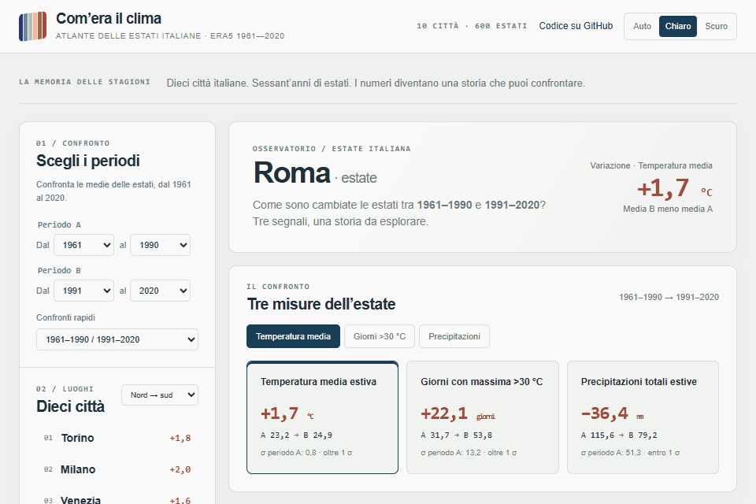
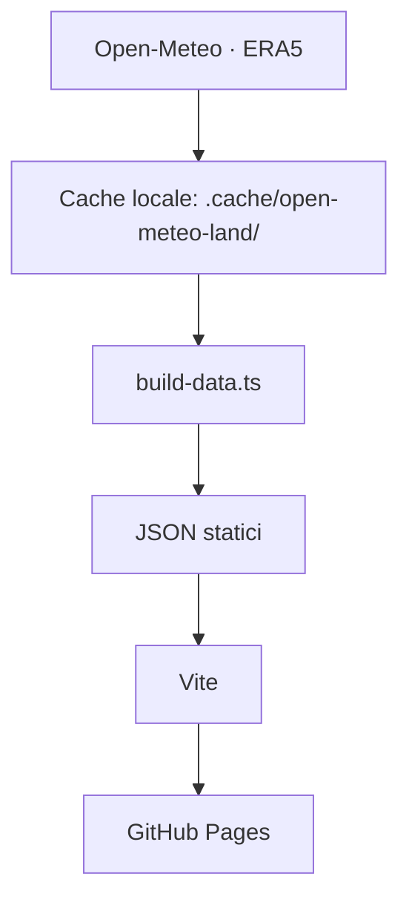

# Com’era il clima

Confronta le estati di dieci città italiane dal 1961 al 2020 con dati climatici ERA5.

[![CI][ci-badge]][ci-workflow]

**[Apri la demo][demo]**

[][demo]

[Immagine statica](docs/media/demo.png) · [Come registrare la GIF](docs/RECORDING.md)

## Dai dati al sito



Il download e l'elaborazione dei dati sono separati dalla build del sito. Durante la visita il
browser legge i JSON già preparati e non chiama l'API climatica. La cache grezza rimane locale; solo
i dati elaborati sono pubblicati.

## Cosa puoi esplorare

- Temperatura media estiva, giorni con massima >30 °C e precipitazioni totali.
- Confronto tra periodi modificabili; quelli iniziali sono 1961–1990 e 1991–2020.
- Mappa, grafico annuale e media mobile, strisce delle anomalie e confronto tra città.
- Dettaglio del singolo anno, tabella di 60 estati e download CSV.
- Collegamenti che conservano città, indicatore, periodi e vista; tema chiaro e scuro.

Il progetto usa TypeScript strict, Vite, Vitest e Playwright. La struttura dei moduli è descritta in
[ARCHITECTURE.md](docs/ARCHITECTURE.md). Versione logica dei dati: `4e434940c5eff13b`, rigenerati il
6 ottobre 2026.

## Come l'ho costruito

- Ho affidato all’agente l’analisi del codice, la preparazione delle modifiche e l’esecuzione dei
  controlli, chiedendo un piano prima degli interventi.
- Ho controllato l’interfaccia e richiesto correzioni concrete: giorni annuali senza decimali,
  legenda della mappa ed etichette accessibili delle anomalie.
- Ho approvato la scelta delle celle ERA5 sulla terraferma e l’adattamento delle temperature
  all’altitudine. Per Venezia abbiamo documentato un dubbio ancora aperto, senza presentarlo come un
  errore dimostrato.
- Ho fatto separare la formattazione dalla suddivisione del codice in moduli, scegliendo un limite
  di 300 righe per file e controlli dopo ogni estrazione.
- Ho imparato a procedere con branch dedicati e pull request, aspettando i controlli automatici
  verdi prima del merge. Ho anche visto perché i test devono essere accompagnati dalla verifica dei
  dati e dell’interfaccia.

Le motivazioni e i compromessi sono registrati in [DECISIONS.md](docs/DECISIONS.md).

## Avvio locale

Richiede Node.js 22.

```bash
npm ci
npm run dev
```

Il percorso locale è `http://localhost:5173/comera-il-clima/`.

## Comandi

```bash
npm run lint
npm run format:check
npm run source:check
npm run typecheck
npm test
npm run data:validate
npm run build
npm run test:e2e
```

La pipeline dati è manuale e separata dalla build ordinaria:

```bash
npm run data:fetch -- --city roma --from 1961 --to 1961
npm run data:fetch -- --all
npm run data:build
npm run data:summers
npm run data:validate
```

La cache grezza viene salvata in `.cache/open-meteo-land/` e non entra nel repository. La cache
originale `.cache/open-meteo/` è conservata per il confronto. Non eseguire `data:build` senza una
cache completa e validata.

`npm run data:compare` confronta i nuovi dati con la versione precedente alla revisione `land`.
Mostra medie A, B e differenza B−A prima/dopo per tutti i tre indicatori e le dieci città. Il
confronto include anche l'adattamento all'altitudine; il caso di Venezia resta da verificare. Si
vedano [metodologia](docs/METHODOLOGY.md) e [decisioni](docs/DECISIONS.md).

`data:build` genera anche `summers.json` quando la cache completa è disponibile. Per rigenerare solo
il riepilogo compatto dai JSON cittadini pubblicati, usare `npm run data:summers`. I confini locali
sono già nel repository; per rigenerarli esplicitamente dalla versione fissata di world-atlas, usare
`npm run geo:build` (richiede rete soltanto in fase di preparazione).

## Licenze e crediti

Il codice del progetto è distribuito con [licenza MIT](LICENSE). I dati climatici provengono dalla
[Open-Meteo Historical Weather API](https://open-meteo.com/en/docs/historical-weather-api), con
modello ERA5 esplicito: la fonte sottostante è il
[Copernicus Climate Change Service (C3S), gestito da ECMWF][era5].
I dati ottenuti tramite l'API sono disponibili secondo
[CC BY 4.0](https://creativecommons.org/licenses/by/4.0/).

Questo progetto ha modificato i dati: ha selezionato le estati giugno–agosto del 1961–2020,
calcolato tre indicatori annuali e le medie dei due trentenni. **Contiene informazioni modificate
del Copernicus Climate Change Service (elaborazione 2026).** Né la Commissione europea né ECMWF sono
responsabili dell'uso che può essere fatto delle informazioni o dei dati Copernicus qui contenuti.
Attribuzioni, trasformazioni e condizioni di riuso sono dettagliate in
[DATA_LICENSE.md](DATA_LICENSE.md).

I [termini di Open-Meteo](https://open-meteo.com/en/terms) riservano l'API gratuita agli usi non
commerciali. Questa condizione riguarda l'accesso al servizio; il riuso dei dati ottenuti tramite
l'API segue CC BY 4.0, anche per usi commerciali con attribuzione.

L'interfaccia è stata adattata dal design consegnato dal proprietario del progetto con Claude
Design. Usa [IBM Plex Sans e Mono](https://github.com/IBM/plex), disponibili secondo
[SIL Open Font License 1.1](https://github.com/IBM/plex/blob/master/LICENSE.txt) e caricati da
Google Fonts.

La mappa usa confini di [Natural Earth](https://www.naturalearthdata.com/about/terms-of-use/)
(pubblico dominio), distribuiti tramite [world-atlas 2.0.2](https://github.com/topojson/world-atlas)
(ISC) e salvati localmente. La mappa non scarica confini durante la visita.

## Avvertenze sui dati

I valori ERA5 rappresentano celle di una griglia climatica, non misure di stazioni meteorologiche né
medie dell'intero territorio comunale. Il confronto termina nel 2020, descrive i periodi scelti e
non dimostra le cause delle differenze. Le elaborazioni sono informative e non sostituiscono dati
locali ufficiali o analisi per decisioni operative. I fornitori non garantiscono l'assenza di errori
nei dati. Si vedano [metodologia e limiti](docs/METHODOLOGY.md) e
[termini di Open-Meteo](https://open-meteo.com/en/terms).

## Metodologia e provenienza

- [Metodologia](docs/METHODOLOGY.md)
- [Fonti e provenienza](docs/DATA_SOURCES.md)
- [Licenza dei dati](DATA_LICENSE.md)
- [Verifica pilota della fonte](docs/DATA_CHECK.md)
- [Piano operativo](docs/PLAN.md)

## Contribuire

Le istruzioni per aggiungere una città, rigenerare i dati ed eseguire le verifiche sono in
[CONTRIBUTING.md](CONTRIBUTING.md).

[ci-badge]: https://github.com/giubud/comera-il-clima/actions/workflows/ci.yml/badge.svg?branch=main
[ci-workflow]: https://github.com/giubud/comera-il-clima/actions/workflows/ci.yml
[demo]: https://giubud.github.io/comera-il-clima/
[era5]: https://cds.climate.copernicus.eu/datasets/reanalysis-era5-single-levels
