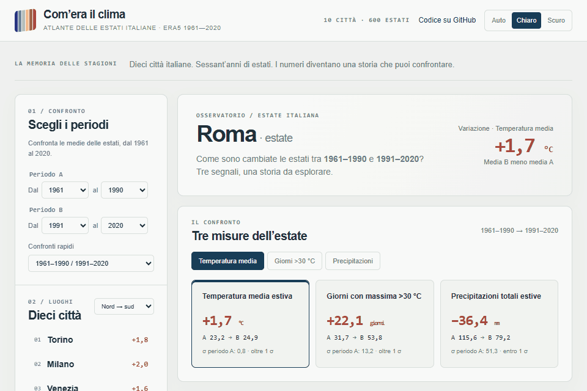
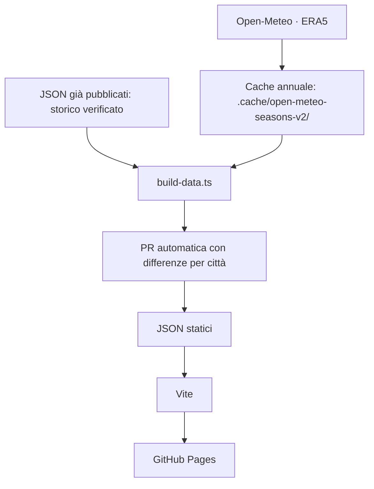

# Com’era il clima

Confronta le quattro stagioni di dieci città italiane dal 1961 con dati climatici ERA5.

[![CI][ci-badge]][ci-workflow]

**[Apri la demo][demo]**

[][demo]

La GIF mostra la vista estiva della prima edizione.

[Immagine statica](docs/media/demo.png) · [Come registrare la GIF](docs/RECORDING.md)

## Dai dati al sito



Il download e l'elaborazione dei dati sono separati dalla build del sito. Durante la visita il
browser legge i JSON già preparati e non chiama l'API climatica. La cache grezza rimane locale; solo
i dati elaborati sono pubblicati.

## Cosa puoi esplorare

- Inverno, primavera, estate e autunno meteorologici.
- Temperatura media, giorni con massima >30 °C, precipitazioni totali, giorni di gelo
  (minima <0 °C) e giorni con precipitazioni ≥20 mm.
- Indicatori esclusi esplicitamente dalla vista quando previsto: “Non applicabile”.
- Confronto tra periodi modificabili; quelli iniziali sono 1961–1990 e 1991–2020.
- Mappa, grafico annuale e media mobile, strisce delle anomalie e confronto tra città.
- Dettaglio del singolo anno, tabella dell'intero archivio e download CSV.
- Collegamenti che conservano città, stagione, indicatore, periodi e vista; tema chiaro e scuro.

Il progetto usa TypeScript strict, Vite, Vitest e Playwright. La struttura dei moduli è descritta in
[ARCHITECTURE.md](docs/ARCHITECTURE.md). Lo schema 2 indica nel manifest l'ultimo anno
disponibile; selettori, grafici, tabella, CSV e URL seguono questo limite.
Il riferimento B1 contiene 2.400 stagioni 1961–2020, versione `1fdffa12eabc7b22`.
Le 600 estati e i tre indicatori precedenti restano esattamente invariati.

## Come l'ho costruito

- Ho affidato all’agente l’analisi del codice, la preparazione delle modifiche e l’esecuzione dei
  controlli, chiedendo un piano prima degli interventi.
- Ho controllato l’interfaccia e richiesto correzioni concrete: giorni annuali senza decimali,
  legenda della mappa ed etichette accessibili delle anomalie.
- Ho approvato la scelta delle celle ERA5 sulla terraferma e l’adattamento delle temperature
  all’altitudine. Per Venezia abbiamo documentato un dubbio ancora aperto, senza presentarlo come un
  errore dimostrato.
- Ho fatto separare la formattazione dalla suddivisione del codice in moduli, scegliendo un limite
  di 300 righe per file e controlli dopo ogni estrazione.
- Ho imparato a procedere con branch dedicati e pull request, aspettando i controlli automatici
  verdi prima del merge. Ho anche visto perché i test devono essere accompagnati dalla verifica dei
  dati e dell’interfaccia.

Le motivazioni e i compromessi sono registrati in [DECISIONS.md](docs/DECISIONS.md).

## Avvio locale

Richiede Node.js 22.

```bash
npm ci
npm run dev
```

Il percorso locale è `http://localhost:5173/comera-il-clima/`.

## Comandi

```bash
npm run lint
npm run format:check
npm run source:check
npm run typecheck
npm test
npm run data:validate
npm run build
npm run test:e2e
```

Il riferimento B1 è pubblicato tramite PR n. 10. Le estati originali sono conservate;
la loro preparazione ha richiesto due finestre giornaliere di quota.
Vedere [schema stagionale e procedura](docs/SEASONS.md).

La pipeline dati rimane separata dalla build ordinaria:

```bash
npm run data:fetch -- --all --from 2021 --to 2025 --limit 300
npm run data:status
npm run data:build -- --to 2025
npm run data:summers
npm run data:validate
```

La nuova cache annuale è `.cache/open-meteo-seasons-v2/`. Le estati conservano la fonte
`.cache/open-meteo-land/`; entrambe sono locali e non entrano nel repository. La cache
originale `.cache/open-meteo/` è conservata per il confronto. L'esempio aggiunge il 2021–2025
al riferimento B1: per aggiornamenti successivi partire dall'anno dopo `manifest.lastYear`.
`data:build` usa lo storico già validato e richiede la cache solo degli anni aggiunti.
Senza `--to` verifica e conserva l'archivio corrente; senza novità non cambia neppure `generatedAt`.
La ricostruzione storica `data:build -- --rebuild` richiede entrambe le cache originali
complete ed è separata dagli aggiornamenti; non riduce un archivio già esteso oltre il 2020.

## Aggiornamento annuale tramite GitHub Actions

Il workflow [Refresh climate data](.github/workflows/data-refresh.yml) parte dal branch `main`:

- a mano, da **Actions → Refresh climate data → Run workflow**;
- ogni **1° marzo alle 05:17 UTC**, cioè le 06:17 italiane in quella data.

`to_year` è l'ultimo anno da aggiungere. Vuoto significa anno precedente: nel 2026 è il 2025.
Si accettano soltanto anni completi, senza ridurre lo storico. L'inverno mantiene la convenzione
dell'anno finale: inverno 2025 = dicembre 2024–febbraio 2025.

Il primo avvio dopo l'integrazione di B2 può proporre l'estensione 2021–2025: 50 richieste annuali,
circa 1.305 unità di quota e almeno 25 minuti di attese, oltre a rete e controlli.
La preparazione conserva lo storico verificato, scarica solo gli anni mancanti, esegue build,
validazione, tutti i controlli di codice ed E2E e prepara una PR con riepilogo per città e stagione.
Il branch gestito è `automation/data-refresh-<anno>`; nessun merge è automatico.
Una ripetizione senza dati nuovi non cambia i JSON e non apre una PR duplicata.

Le cache annuali e le quote sono salvate anche dopo un errore. Le cache GitHub possono essere
eliminate dopo sette giorni senza accessi: sono un'accelerazione, non l'unica copia dello storico.
Un 429 indica troppe richieste: il programma rispetta `Retry-After`, tenta al massimo tre volte
e si ferma; una pausa lunga imposta dalle quote può interromperlo già prima. Riprendere soltanto
dopo l'orario indicato, senza azzerare quote o cache.

Il job di preparazione ha solo `contents: read`. Il job separato che propone i dati riceve
`contents: write` per il branch e `pull-requests: write` per la PR. Tutti gli altri permessi
sono disabilitati; nessun token personale, permesso di deploy o approvazione automatica.
Occorre consentire alle Actions di creare PR nelle impostazioni del repository.
Le CI delle PR create con `GITHUB_TOKEN` richiedono l'approvazione del proprietario per partire.
La revisione e il merge restano manuali, con i controlli richiesti verdi.

GitHub può disattivare le pianificazioni nei repository pubblici dopo 60 giorni di inattività:
controllare che il workflow sia abilitato prima della scadenza annuale.
Procedura, permessi e ripresa sono descritti in [CONTRIBUTING.md](CONTRIBUTING.md).

`npm run data:compare` confronta i nuovi dati con la versione precedente alla revisione `land`.
Mostra medie A, B e differenza B−A prima/dopo per tutti i tre indicatori e le dieci città. Il
confronto include anche l'adattamento all'altitudine; il caso di Venezia resta da verificare. Si
vedano [metodologia](docs/METHODOLOGY.md) e [decisioni](docs/DECISIONS.md).

`data:build` genera lo schema 2 e quattro riepiloghi stagionali solo con la cache completa. Per rigenerare solo
i quattro riepiloghi compatti dai JSON cittadini, usare `npm run data:summers`. I confini locali
sono già nel repository; per rigenerarli esplicitamente dalla versione fissata di world-atlas, usare
`npm run geo:build` (richiede rete soltanto in fase di preparazione).

## Licenze e crediti

Il codice del progetto è distribuito con [licenza MIT](LICENSE). I dati climatici provengono dalla
[Open-Meteo Historical Weather API](https://open-meteo.com/en/docs/historical-weather-api), con
modello ERA5 esplicito: la fonte sottostante è il
[Copernicus Climate Change Service (C3S), gestito da ECMWF][era5].
I dati ottenuti tramite l'API sono disponibili secondo
[CC BY 4.0](https://creativecommons.org/licenses/by/4.0/).

Questo progetto ha modificato i dati: ha selezionato le quattro stagioni meteorologiche
del 1961–2020, calcolato cinque indicatori e le medie dei due trentenni.
L’inverno 1961 include dicembre 1960; la fonte estiva originale è conservata. **Contiene informazioni modificate
del Copernicus Climate Change Service (elaborazione 2026).** Né la Commissione europea né ECMWF sono
responsabili dell'uso che può essere fatto delle informazioni o dei dati Copernicus qui contenuti.
Attribuzioni, trasformazioni e condizioni di riuso sono dettagliate in
[DATA_LICENSE.md](DATA_LICENSE.md).

I [termini di Open-Meteo](https://open-meteo.com/en/terms) riservano l'API gratuita agli usi non
commerciali. Questa condizione riguarda l'accesso al servizio; il riuso dei dati ottenuti tramite
l'API segue CC BY 4.0, anche per usi commerciali con attribuzione.

L'interfaccia è stata adattata dal design consegnato dal proprietario del progetto con Claude
Design. Usa [IBM Plex Sans e Mono](https://github.com/IBM/plex), disponibili secondo
[SIL Open Font License 1.1](https://github.com/IBM/plex/blob/master/LICENSE.txt) e caricati da
Google Fonts.

La mappa usa confini di [Natural Earth](https://www.naturalearthdata.com/about/terms-of-use/)
(pubblico dominio), distribuiti tramite [world-atlas 2.0.2](https://github.com/topojson/world-atlas)
(ISC) e salvati localmente. La mappa non scarica confini durante la visita.

## Avvertenze sui dati

I valori ERA5 rappresentano celle di una griglia climatica, non misure di stazioni meteorologiche né
medie dell'intero territorio comunale. L'ultimo anno è indicato nella demo; il confronto descrive
i periodi scelti e
non dimostra le cause delle differenze. Le elaborazioni sono informative e non sostituiscono dati
locali ufficiali o analisi per decisioni operative. I fornitori non garantiscono l'assenza di errori
nei dati. Si vedano [metodologia e limiti](docs/METHODOLOGY.md) e
[termini di Open-Meteo](https://open-meteo.com/en/terms).

## Metodologia e provenienza

- [Metodologia](docs/METHODOLOGY.md)
- [Fonti e provenienza](docs/DATA_SOURCES.md)
- [Licenza dei dati](DATA_LICENSE.md)
- [Verifica pilota della fonte](docs/DATA_CHECK.md)
- [Piano operativo](docs/PLAN.md)

## Contribuire

Le istruzioni per aggiungere una città, rigenerare i dati ed eseguire le verifiche sono in
[CONTRIBUTING.md](CONTRIBUTING.md).

[ci-badge]: https://github.com/giubud/comera-il-clima/actions/workflows/ci.yml/badge.svg?branch=main
[ci-workflow]: https://github.com/giubud/comera-il-clima/actions/workflows/ci.yml
[demo]: https://giubud.github.io/comera-il-clima/
[era5]: https://cds.climate.copernicus.eu/datasets/reanalysis-era5-single-levels
