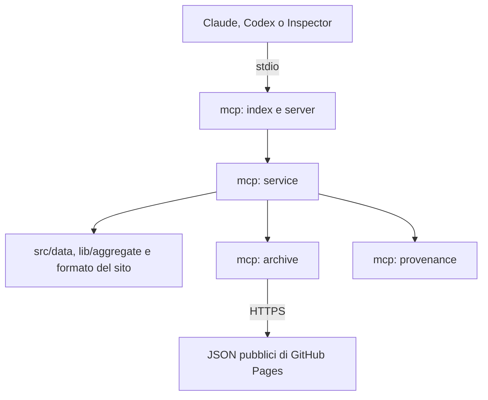
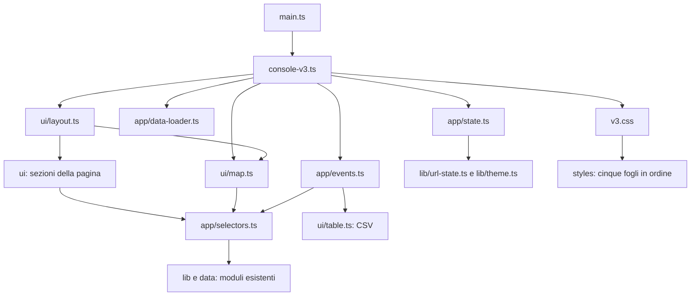

# Struttura dell'applicazione

## Server MCP — B3

Il pacchetto `mcp/` aggiunge un processo Node 22 con trasporto stdio. Non entra nella build
del sito e non offre un endpoint HTTP. `server.ts` registra quattro strumenti con SDK ufficiale,
input e risultati strutturati Zod; `index.ts` avvia il trasporto con stdout riservato al protocollo.

`ArchiveStore` condivide le letture concorrenti, conserva manifest e città per dieci minuti
e assegna uno snapshot a ogni chiamata. Schema e hash impediscono di unire versioni diverse
durante una pubblicazione parziale. Un errore scarta solo il caricamento fallito e non produce
risposte con cache scaduta. L’unico indirizzo runtime è quello dei JSON statici pubblici.

`service.ts` usa `compactSeason`/`expandSeason` per riprodurre la precisione del sito e
`rangeStats` per le medie; calendario ed esclusioni sono condivisi. `provenance.ts` seleziona
fonte estiva originale, annuale o estensione dell’anno e segnala scarti UTC differenti.
Unità, licenza, versione e limiti accompagnano ciascun risultato; null non diventa zero.

Il job CI `mcp` usa soltanto lettura del repository e non dipende dai servizi climatici.
I test verificano i dati reali locali, i casi di errore, la cache, il protocollo e la build stdio.
Configurazioni personali e prove manuali sono documentate in [mcp/README.md](../mcp/README.md).

## Aggiornamenti B2

`data-refresh.yml` separa il job `prepare`, in sola lettura del repository, da `propose`,
che può scrivere la proposta di dati secondo il codice del workflow.
La concorrenza è serializzata; la cache annuale conserva avanzamento e quote anche sugli errori.
Il job che propone i dati riceve un artefatto già verificato e non installa dipendenze.

`refresh-plan.ts` valida anno e archivio iniziale. `fetch-client.ts` applica tentativi limitati
passando sempre da `fetch-quota.ts`. `refresh-data.ts` conserva lo storico e aggiunge le annualità;
`refresh-build.ts` pubblica solo dopo validazione completa e gestisce recupero e assenza di novità.
`refresh-summary.ts` rifiuta modifiche allo storico e descrive le differenze per città/stagione.
`publish-refresh.mjs` è protetto contro l'avvio locale: su Actions aggiorna il branch automatico,
senza force push o merge della PR, e apre o aggiorna la proposta. Non scrive direttamente su `main`.

Nello schema 2 gli intervalli sono dinamici; le fonti storiche restano intatte e `extensions`
registra le nuove provenienze. I moduli della vista leggono il manifest per URL, periodi,
navigazione, conteggi e scala del grafico. I vecchi URL e confronti iniziali restano validi.

## Moduli dell'interfaccia

`main.ts` carica `console-v3.ts`, che crea lo stato e collega caricamenti, eventi e pagina.
Le sezioni leggono lo stato ricevuto; eventi e caricamenti lo aggiornano.
Calcoli, URL, tema e formato dei dati riusano le librerie esistenti.

## Stato, caricamenti e interazioni

- `app/state.ts`: scelte nell'URL, aspetto e dati disponibili, con tipi espliciti.
- `app/selectors.ts`: serie cittadine, variazioni, anno selezionato e ordine delle città.
- `app/data-loader.ts`: JSON iniziali, geografia, cache cittadina e richieste concorrenti.
- `app/events.ts`: mouse, tastiera, selettori, cronologia, collegamento e download CSV.

Il caricatore conserva un contatore delle richieste: una risposta vecchia non sostituisce
la città scelta più recentemente. Il formato dell'URL e la chiave locale del tema sono invariati.

## Sezioni della pagina

- `ui/header.ts` e `ui/sidebar.ts`: intestazione, tema, periodi e scelta della città.
- `ui/overview.ts`: riepilogo e tre schede degli indicatori.
- `ui/chart.ts` e `ui/stripes.ts`: grafico annuale ed etichette accessibili delle anomalie.
- `ui/year.ts`: anno selezionato e valori nelle dieci città.
- `ui/comparison.ts` e `ui/annual.ts`: confronto tra città e archivio annuale.
- `ui/map.ts`: legenda, disegno della mappa e osservatore del ridimensionamento.
- `ui/display.ts`: piccoli formati condivisi; `ui/layout.ts` compone la pagina.
- `ui/legal.ts` e `ui/table.ts`: informazioni legali e generazione CSV esistenti.

I frammenti HTML mantengono i testi e gli spazi originari. Le stringhe lunghe sono divise
in parti concatenate, così la pagina resta identica e il sorgente rispetta le 100 colonne.

## Stili e limiti

`v3.css` importa, in quest'ordine, `base.css`, `dashboard.css`, `visualizations.css`,
`details.css`, `overrides.css`. Selettori, dichiarazioni e ordine della cascata sono invariati.
Le regole per schermi piccoli e gli ultimi adattamenti della mappa rimangono alla fine.

`npm run source:check` impone un massimo di 300 righe per file e 100 caratteri per riga
per tutti i sorgenti TypeScript e CSS in `src/`. Il conteggio include commenti e righe vuote.
La CI esegue il controllo dopo lint e formattazione. Git conserva i file di testo con LF,
evitando che un checkout Windows annulli la formattazione o alteri le impronte dei dati.

## Console stagionale e compatibilità dello schema 1

`console-v3.ts` legge il manifest: schema 1 avvia la console estiva, schema 2 carica
il modulo `seasons/console.ts`. Un URL stagionale su dati schema 1 mostra un avviso esplicito.
`data/legacy.ts` mantiene i contratti precedenti; calendario, schema e controlli stagionali
sono separati. `lib/season-aggregate.ts` calcola i cinque indicatori e le medie annuali.

`seasons/model.ts` e `lib/season-url-state.ts` gestiscono stato e valori; `seasons/events.ts`
le interazioni. Views, tables, plots e map compongono le sezioni. Un contatore per caricamento
impedisce alle risposte vecchie di sostituire l'ultima selezione. I JSON compatti sono memorizzati
per stagione; il dettaglio è memorizzato per città. Si aggiunge il foglio `styles/seasons.css`.

La build dati è separata: fonti annuali + estati originali → validazione e regressione →
area temporanea → sostituzione dei JSON. Il browser non chiama l'API meteorologica.
[SEASONS.md](SEASONS.md) documenta formato, cache, comandi e vincoli di provenienza.
